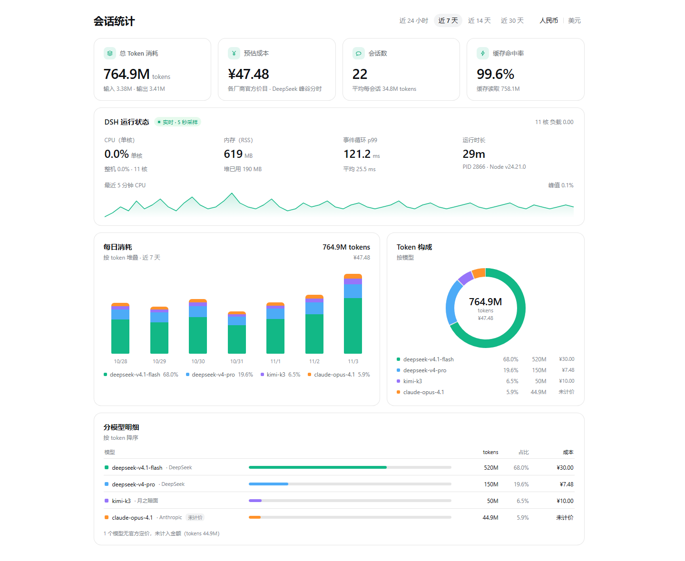
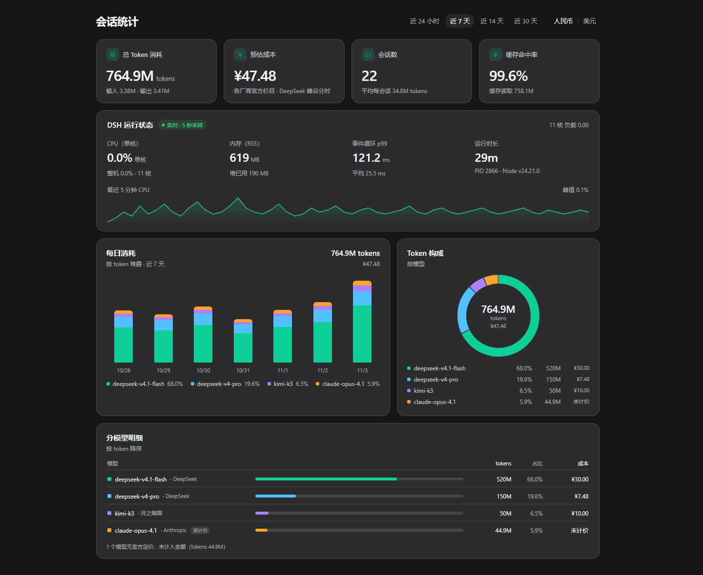

# dsh-session-stats-panel —— DSH「会话统计」侧栏页面

一个零第三方依赖的本地 DSH Web 插件：在左侧栏「自动化任务」下面新增一个独立的
**「会话统计」页面**（不是设置页、不是弹窗），复刻会话用量看板：

- 顶部：大标题 + 时间档（近 24 小时 / 近 7 天 / 近 14 天 / 近 30 天）+ 币种（人民币 / 美元）；
- 第一行四张等宽指标卡：总 Token 消耗、预估成本、会话数、缓存命中率；
- 第二张横跨整行的「DSH 运行状态」卡：CPU（单核）/ 内存（RSS）/ 事件循环 p99 / 运行时长，
  外加一条 5 分钟 CPU 面积折线；
- 第三行并排：「每日消耗」**按模型分色**的堆叠柱状图 +「Token 构成」**按模型分段**的环形图；
- 第四张横跨整行的「分模型明细」卡：模型 / tokens / 占比条 / 成本。

图表全部是手写内联 SVG / CSS，没有任何图表库；主题跟随宿主明暗色（消费
`--dsw-alias-*` 设计 token，并带浅色兜底值），浅色为白底 + `#e8eaed` 细边框，
主色为 `#12b886` / `#0ca678`。图表颜色只取自宿主响应里的 `modelPalette`（10 色：
绿/蓝/紫/橙/青/粉/黄/靛/棕/灰，绿色只占第一位），深色主题只对色块做亮度/饱和度微调，
不维护第二套硬编码色板。

## 预览

浅色（近 7 天档，按模型分色）：



深色（跟随宿主主题）：



## 安装

把仓库克隆/下载到任意目录，下面用 `<插件目录>` 表示它的绝对路径。

```bash
git clone https://github.com/Oblivionis7999/dsh-session-stats-panel.git
```

```powershell
# 本地开发安装（不复制文件，link 到 profile）
dsh plugin --profile web add "link:<插件目录>"

# 卸载
dsh plugin --profile web remove dsh-session-stats-panel
```

### 从 GitHub 安装（推荐分发给别人）

```bash
dsh plugin --profile web add "git+https://github.com/Oblivionis7999/dsh-session-stats-panel.git"
```

装完重启 DSH（bundle 列表变化不支持热重载），浏览器 Ctrl+Shift+R 强刷。

`dsh plugin add` 会把依赖写进 profile 的 `package.json`、把本包的
`cordis.patch.yml` 叠加进 profile bundle 层。装好后重启/刷新 Web 界面，
左侧栏「自动化任务」下面就会出现「会话统计」。

> 本包**不修改**任何 profile 配置、不监听端口、不写用户数据；宿主半只注册两条
> 只读 HTTP 路由。

## 目录结构

```
dsh-session-stats-panel/
├─ package.json          # name / type: module / main: lib/index.js / dsh.bundle.patch / dsh.client
├─ cordis.patch.yml      # bundle patch：insert 本插件行（含可选 config）
├─ icon.svg              # 插件市场/管理器图标
├─ locale/zh.json        # 包元信息文案（插件列表用）
├─ locale/en.json
├─ index.js              # 宿主半的别名入口（re-export lib/index.js，方便直接引用）
├─ lib/
│  ├─ index.js           # 宿主半：路由注册 + 增量缓存 + /live 采样（package main）
│  ├─ pricing.js         # 纯函数：价目表、峰谷判定、costOfUsage、USD 换算
│  └─ aggregate.js       # 纯函数：事件 → 会话小时桶 → 窗口汇总/日桶/模型桶/构成
├─ client.js             # 浏览器半：__ModuleLoader__ 包装，React + 内联 SVG
├─ README.md
└─ tools/
   ├─ selfcheck.mjs      # 纯核心冒烟：伪造事件 → token/成本/命中率断言
   ├─ selfcheck-host.mjs # 假 ctx 跑 apply()，直接调用两条路由 handler
   └─ selfcheck-client.mjs # 假 window/document/React 渲染页面，断言文案与数字
```

## 页面与交互

| 区域 | 内容 |
| --- | --- |
| 时间档 | `近 24 小时`（24 个整点桶）/ `近 7 天` / `近 14 天` / `近 30 天`（按北京自然日对齐，含今天）。默认 `近 7 天`。 |
| 币种 | `人民币 \| 美元`。人民币是权威口径，美元按 `usdRate`（默认 7.1）派生显示，切换不重新请求。 |
| 总 Token 消耗 | 四个互斥桶相加（未缓存输入 + 输出 + 缓存读取 + 缓存写入），副行给输入/输出。 |
| 预估成本 | **原厂官方价目**本地估算：DeepSeek 按峰/谷逐条计价，其它厂商平铺单价，海外厂商 USD 按 `usdRate` 折算。查不到官方价目的模型 `priceLevel:"unpriced"`、成本记 0，明细成本列显示「未计价」，表底灰字提示「N 个模型无官方定价，未计入金额（tokens x.xxM）」。 |
| 会话数 | 窗口内至少有一条 usage 事件的会话数；副行给每会话平均 token。 |
| 缓存命中率 | `缓存读取 / (未缓存输入 + 缓存读取 + 缓存写入)`，副行给缓存读取量。 |
| DSH 运行状态 | 每 5 秒采样 CPU（单核 %、整机 %、核数、负载）、RSS/堆、事件循环 p99/均值、运行时长、PID、Node 版本；底部是 60 点（5s × 60 = 300s）CPU 环形缓冲折线。 |
| 每日消耗 | **按模型**分色堆叠的柱状图（同一天内按模型 token 占比分段），柱下方图例最多 6 个模型 +「其他」，右上角给窗口总量与成本。 |
| Token 构成 | **按模型**分段的环形图，中心仍是总量 + `tokens` + 成本；图例每行 = 色块 + 模型名 + 占比% + tokens + 成本。 |
| 分模型明细 | 第三张卡（整行）：色块 + 模型名（+ provider）+ 占比条 + tokens + 占比 + 成本，按 token 降序。 |

## 数据口径

宿主半只读 `ctx.sessionQuery`，**不写**任何会话数据。

- 语料：`await ctx.sessionQuery.listSessions()` → `SessionRecord[]`（取 `header.id` / `header.createdAt`）。
- 事件：`await ctx.sessionQuery.readSession(id)` → `{ session, inheritedEventCount, events }`。
- 只处理 `event.type === "assistant/message"` 且带 `data.usage` 的事件；`assistant/attempt`、
  非消息事件、空 usage、时间戳非法的事件一律安全跳过，绝不抛错。
- `event.time` 是毫秒 epoch，按北京时区（UTC+8）归入小时桶/自然日桶。
- `TokenUsage` 的四桶是互斥的：`inputTokens` 是**未缓存输入**，因此
  `总 token = inputTokens + outputTokens + cacheReadTokens + cacheWriteTokens`；
  缓存命中率分母为 `inputTokens + cacheReadTokens + cacheWriteTokens`（为 0 时记 0）。
- 模型/供应商来自 `data.message.source = { kind: "model", provider, model }`；
  缺失时路由为 `unknown/unknown`（按 Flash 档估算）。
- 每个小时桶都带 `models: Map<route, …>`，合并到日桶时模型也一起合并；响应里
  `daily[i].models` 是该日各模型的 `{ route, label, color, vendor, priceLevel, tokens, costCNY, share }`，
  同一日各模型 token 之和恒等于该日 `tokens`。
- 模型颜色稳定：响应里的 `modelPalette`（10 色）按 **route 在窗口内首次出现的顺序**分配，
  第 11 个及以后归入中性灰的「其他」切片；客户端不硬编码颜色，只读 `color` 字段。
- 会话数 = 窗口内出现过 usage 事件的会话数；平均值 = 窗口总量 / 会话数。
- 时间窗口按北京时区对齐：`近 7 天` 是「今天及之前 6 个自然日」，柱状图与汇总严格同源，
  所以柱子之和恒等于卡片总量。

### 缓存与增量

- `overview` 响应缓存 `ttlMs`（默认 60s）。
- 会话级缓存按 `ctx.sessionPersistence.list()` 的 `revision`（不透明变更令牌，
  JSONL 后端由文件 size/mtime 派生）判断是否变化：**只有 revision 变了的会话才重新
  `readSession`**，其余直接复用内存里的聚合结果。没有 persistence 后端时退化为
  「每会话 60s TTL」。
- 单次扫描并发上限 `sessionConcurrency`（默认 3），单会话读取超时 `readTimeoutMs`
  （默认 10s），单会话失败只记日志、不影响其它会话。
- 内存里只保留最近 31 天的按小时桶（最大窗口 30 天），旧桶自动裁剪。

## 价格与峰谷

**只认「模型原厂官方价目」**：DeepSeek→DeepSeek、GLM→智谱、Kimi→Moonshot、Grok→xAI、
GPT→OpenAI、Claude→Anthropic、Qwen→阿里云、MiniMax→MiniMax、混元→腾讯、Step→阶跃、
MiMo→小米、LongCat→美团。转售/聚合平台价（OpenCode Zen 等）与跨厂商兜底价**一律不用**。

查不到官方价目的模型**不猜、不计钱**：响应里 `priced:false`、`costCNY:0`、
`priceLevel:"unpriced"`、`priceKey:null`、`sourceUrl:null`；分模型明细的成本列显示
「未计价」，表底灰字提示「N 个模型无官方定价，未计入金额（tokens x.xxM）」，`totals`
里同时给出 `unpricedModels` / `unpricedTokens`。

### 已核验的原厂价目（抓取日 2026-11-04，单位：百万 token）

| 厂商 | 模型 | 币种 | 缓存命中 | 未命中输入 | 输出 | 来源 |
| --- | --- | --- | --- | --- | --- | --- |
| DeepSeek | `deepseek-flash`（峰 ×2） | CNY | 0.02 | 1 | 4 | [链接](https://api-docs.deepseek.com/zh-cn/quick_start/pricing) |
| DeepSeek | `deepseek-v4-pro`（峰 ×2） | CNY | 0.15 | 4.5 | 13.5 | 同上 |
| 智谱 | GLM-5.3 | CNY | 2 | 8 | 28 | [链接](https://docs.bigmodel.cn/cn/guide/start/pricing.md) |
| 智谱 | GLM-5.3-Flash | CNY | 0.23 | 0.8 | 2.8 | 同上 |
| 智谱 | GLM-5.3-FlashX | CNY | 0.57 | 2 | 7 | 同上 |
| 智谱 | GLM-5.2 | CNY | 2 | 8 | 28 | 同上 |
| 智谱 | GLM-5.1（<32K 档） | CNY | 1.3 | 6 | 24 | 同上 |
| 阿里云 | Qwen3.8 Max（北京） | USD | 0.165 | 1.65 | 4.951 | [链接](https://www.alibabacloud.com/help/zh/model-studio/model-pricing) |
| 阿里云 | Qwen3.8 Flash（北京） | USD | 0.0113 | 0.113 | 0.382 | 同上 |
| 阿里云 | Qwen3.7 Plus（≤256K） | USD | 0.04 | 0.4 | 1.6 | 同上 |
| MiniMax | MiniMax-M3（≤512K） | CNY | 0.42 | 2.1 | 8.4 | [链接](https://platform.minimax.cn/docs/pricing/overview.md) |
| MiniMax | MiniMax-M3.1-Flash | CNY | 0.1 | 1 | 4 | 同上 |
| 阶跃 | step-5-preview | CNY | 0.7 | 7 | 20 | [链接](https://platform.stepfun.com/docs/zh/guides/pricing/details.md) |
| 小米 | MiMo-V2.6-Pro | CNY | 0.025 | 3 | 6 | [链接](https://mimo.mi.com/docs/zh-CN/price/pay-as-you-go) |
| 小米 | MiMo-V2.6-Flash | CNY | 0.02 | 1 | 2 | 同上 |
| 小米 | MiMo-V2.6-Pro-Ultraspeed | CNY | 0.25 | 30 | 60 | 同上 |
| 美团 | LongCat-2.0 | CNY | 0.1 | 5 | 20 | [链接](https://longcat.chat/platform/docs/zh/pricing/long-cat-2.0) |
| xAI | grok-4.7 / 4.6（<200K） | USD | 0.5 | 2 | 6 | [链接](https://docs.x.ai/developers/pricing) |
| xAI | grok-4.5（<200K） | USD | 0.3 | 2 | 6 | 同上 |
| xAI | grok-4.3（<200K） | USD | 0.2 | 1.25 | 2.5 | 同上 |
| xAI | grok-build-0.1（<200K） | USD | 0.2 | 1 | 2 | 同上 |
| OpenAI | gpt-6-luna / gpt-5.6-luna | USD | 0.01 / 0.02 | 0.1 / 0.2 | 0.5 / 1.2 | [链接](https://developers.openai.com/api/docs/pricing.md) |
| OpenAI | gpt-6.1-sol / 6.1-terra / 6-sol / 5.6-sol / 5.6-terra | USD | 0.1 / 0.05 / 0.2 / 0.4 / 0.2 | 2 / 1 / 2 / 4 / 2 | 10 / 5 / 10 / 20 / 12 | 同上 |
| OpenAI | gpt-5.1 / gpt-5 / gpt-5-mini / gpt-5.4-mini / 5.4-nano / gpt-4.1 / 4o-mini | USD | 0.125 / 0.125 / 0.025 / 0.075 / 0.02 / 0.5 / 0.075 | 1.25 / 1.25 / 0.25 / 0.75 / 0.2 / 2 / 0.15 | 10 / 10 / 2 / 4.5 / 1.25 / 8 / 0.6 | 同上 |
| Anthropic | Claude Fable 5.1 / Opus 5.5 / Sonnet 5.5 | USD | 0.25 / 0.2 / 0.1 | 10 / 4 / 2 | 50 / 20 / 10 | [链接](https://platform.claude.com/docs/en/about-claude/pricing) |
| Anthropic | Claude Haiku 5.5（≤100K） | USD | 0.01 | 0.1 | 0.5 | 同上 |
| Moonshot | Kimi K3 | CNY | 2 | 20 | 100 | [链接](https://platform.kimi.com/docs/pricing/chat) |
| Moonshot | Kimi K3.1 Pro | CNY | 1.3 | 13 | 68 | 同上 |
| Moonshot | Kimi K3.1 Pro Highspeed | CNY | 1.3 | 26 | 136 | 同上 |
| Moonshot | Kimi K2.7 Code | CNY | 1.3 | 6.5 | 27 | 同上 |
| Moonshot | Kimi K2.7 Code Highspeed | CNY | 2.6 | 13 | 54 | 同上 |
| Moonshot | Kimi K2.6 | CNY | 1.1 | 6.5 | 27 | 同上 |
| 腾讯混元 | Hy3（TokenHub） | CNY | 0.25 | 1 | 4 | [链接](https://cloud.tencent.com/document/product/1759/127342) |
| 腾讯混元 | Hy4 preview（TokenHub） | CNY | 0.3 | 6 | 18 | 同上 |
| Google | Gemini 4 Argon（优惠期，~2026-11-30） | USD | 0.1 | 2 | 10 | [链接](https://ai.google.dev/gemini-api/docs/latest-model) |
| Google | Gemini 4 Argon（正式价，2026-12-01 起） | USD | 0.2 | 4 | 20 | 同上 |
| Meta | Muse Spark 1.3 Contributor | USD | 0.15 | 1.25 | 4.25 | 官方 Muse 定价页（运营方提供） |
| Meta | Muse Wonder | USD | 0.2 | 4 | 20 | 同上 |

> 只取**短上下文/标准档**：OpenAI 的 ≥272K 长上下文档、xAI 的 ≥200K 档、阿里云的非北京
> 地域价、Anthropic 的 >100K 档都未实现（注释在 `lib/pricing.js` 表项里说明）。
> 阿里云中国站 CNY 价目为 JS 渲染未能完整核验，故用其官方国际站 USD 价目（同一模型），
> 按 `usdRate` 折算展示；人民币仍是权威口径。
>
> Kimi 的 `cacheWrite` 取官方 **5 分钟 TTL** 写入价；统计不区分缓存 TTL，1 小时档未建模。
> Kimi 别名按同代官方按量价折算：`k3` / `k3-256k` → Kimi K3，`kimi-for-coding` → K2.7 Code，
> `kimi-for-coding-highspeed` → K2.7 Code Highspeed；用户实际可能走 Kimi Code 订阅套餐。
> Gemini 4 Argon 按**事件时间**取价：2026-11-30（含）前用优惠价，2026-12-01 00:00（北京）起用正式价。
> 腾讯混元用 TokenHub 刊例价（批量推理 5 折与开源权重本地部署免费价不采用）。

### 未计价（`priceLevel: "unpriced"`，成本记 0）

- **Reflection Beam / Iceman**：无公开按量计费价目。
- **Meta Muse Spark 1.2**：官方价目未列该版本（1.3 已入表）。
- **小米 MiMo V2.5 / V2.5-Pro**：官方页标注 2026-10-21 已下线。
- **LongCat 2.5 Preview Free**：官方定价页只列 LongCat-2.0。
- 以及任何未列在官方价目表里的模型 id（如 `claude-opus-4.1`、`kimi-k2.7-codex`）。

### 峰谷与汇率

- 峰时：**北京时间工作日 09:00–12:00、14:00–18:00**（左闭右开）；其余时刻、周末、
  `holidays` 列出的日期按谷价。峰谷 ×2 **只作用于 DeepSeek**，其它厂商官方页是平铺单价。
- 缓存写入有独立单价时用独立单价（OpenAI 30m / Anthropic 5m 档），没有时按「未命中输入」价。
- 人民币是权威金额；美元 = 人民币 / `usdRate`（默认 7.1）。中国厂商 CNY 价目不做折算，
  海外厂商 USD 价目按 `usdRate` 折算成 CNY 展示。

> 价格是**本地估算**，只用于看板展示，不是账单；调价后改 `lib/pricing.js` 的
> `OFFICIAL_PRICE_TABLE`（`PRICE_TABLE_VERSION` 会出现在响应里便于排查）。
> 已核验数字都带 `sourceUrl` + `verifiedAt: "2026-11-04"`。

## 官方搜索（server-tool-search）

DSH 的联网搜索走 `dsh-web-search-deepseek`，**每次搜索是一次独立 API 调用**，并在会话日志里留下一条
`web/deepseek-search-llm-request` 事件。计费单位是**这条事件**（每个 query 一次请求），不是
`tool/call` 里的 `web_search`（实测同会话 85 条搜索请求事件 vs 30 条 tool/call，数错会少算）。

- 官方价目：**Search 每 1,000 次成功请求 ¥5**，即 **¥0.005 / 次**，平铺（不参与峰谷、不做汇率折算）。
  来源：<https://api-docs.deepseek.com/zh-cn/quick_start/pricing>（抓取日 2026-11-05）。
- **Fetch 不统计**：DSH 的 `web_fetch` 是本地直连，不走 DeepSeek Fetch API，不产生费用。
- 搜索调用自身的 token（那次 `deepseek-v4-flash` 的 messages 调用）**日志里没有 usage**，本地无法还原
  token 费用，只能统计「按次费用」；因此看板金额与平台账单可能不完全一致，UI 已如实标注。

响应字段：

- `totals.searches` / `totals.searchCostCNY`；`totals.costCNYTotal = totals.costCNY + totals.searchCostCNY`
  （`costCNY` 仍是纯 token 成本，`costCNYWithSearch` 与 `costCNYTotal` 同值）。
- `daily[].searches` / `daily[].searchCostCNY`。
- `models[]` 末尾追加合成行（有搜索时才出现）：
  `{ route: "official/server-tool-search", label: "官方搜索", vendor: "deepseek", priceLevel: "official",
     tokens: 0, costsOnly: true, searches: N, costCNY, shareByCost }`。它**不会**进入环形图/堆叠柱
  （0 token 会让占比失真），只出现在「分模型明细」表与成本卡副行。
- `pricing.search = { unit: "per-request", priceCNY: 0.005, note: "¥5 / 1000 次成功请求" }`。

## 配置项（`cordis.patch.yml` 的 `config`，全部可选）

| 键 | 默认 | 说明 |
| --- | --- | --- |
| `usdRate` | `7.1` | 显示用 CNY→USD 汇率（>0）。 |
| `ttlMs` | `60000` | `overview` 响应缓存毫秒数；`0` 表示每次请求都重算（会话级增量仍生效）。 |
| `window` | `"7d"` | 默认时间档：`24h` / `7d` / `14d` / `30d`。 |
| `liveIntervalMs` | `5000` | `/live` 的 CPU 采样间隔（1000–60000）。 |
| `livePoints` | `60` | CPU 环形缓冲点数（6–600）；默认 5s×60 = 5 分钟。 |
| `sessionConcurrency` | `3` | 扫描时并发 `readSession` 数（1–16）。 |
| `readTimeoutMs` | `10000` | 单会话读取超时。 |
| `maxSessions` | `5000` | 单次响应最多折叠的会话数。 |
| `allowedHosts` | `[]` | 除 `127.0.0.1` / `localhost` / `[::1]` 外额外放行的 Host。 |
| `holidays` | `[]` | 按谷价计费的北京日期，如 `["2026-10-01"]`。 |
| `debug` | `false` | 打开后输出扫描明细日志。 |

## HTTP API（仅本机）

两条 `exact` 路由都由宿主半注册，`Cache-Control: no-store`；`Host` 头不是
`127.0.0.1` / `localhost` / `[::1]` 的请求一律 `403`（可用 `allowedHosts` 放宽）。

### `GET /session-stats/api/overview?window=24h|7d|14d|30d`

```jsonc
{
  "ok": true,
  "generatedAt": 1793718000000,
  "window": { "key": "7d", "granularity": "day", "bucketCount": 7, "from": 0, "to": 0,
              "label": "近 7 天", "points": ["10/28", "...", "11/3"] },
  "currency": { "code": "CNY", "symbol": "¥", "usdRate": 7.1, "usdSymbol": "$" },
  "totals": { "tokens": 764900000, "input": 3380000, "output": 3410000,
              "cacheRead": 758100000, "cacheWrite": 0,
              "costCNY": 47.48, "costUSD": 6.69,
              "cacheHitRate": 0.99556, "sessions": 22, "avgTokensPerSession": 34768182,
              "pricedTokens": 714900000, "unpricedTokens": 50000000, "priced": false,
              "unpricedModels": 1, "searches": 3, "searchCostCNY": 0.015,
              "costCNYTotal": 51.815, "costCNYWithSearch": 51.815, "events": 1234 },
  "pricing": { "tableVersion": "vendor-official-2026-11", "peakMultiplier": 2,
               "peakEvents": 10, "offPeakEvents": 4, "mode": "mixed", "holidays": [],
               "usdRate": 7.1,
               "officialLists": ["vendor-official"],
               "priceLevels": { "official": 2, "unpriced": 1 } },
  "modelPalette": ["#12b886", "#4dabf7", "#9775fa", "#ff922b", "#22b8cf",
                   "#f06595", "#fcc419", "#5c7cfa", "#b08968", "#adb5bd"],
  "otherModelColor": "#868e96",
  "composition": [ { "key": "cacheRead", "tokens": 758100000, "share": 0.991111 }, "..." ],
  "daily": [ { "key": "1", "label": "10/28", "start": 0, "end": 0, "input": 0,
               "output": 0, "cacheRead": 0, "cacheWrite": 0, "tokens": 0,
               "costCNY": 0, "costUSD": 0, "events": 0,
               "models": [ { "route": "deepseek/deepseek-v4.1-flash",
                             "label": "deepseek-v4.1-flash", "color": "#12b886",
                             "tokens": 0, "costCNY": 0, "costUSD": 0,
                             "vendor": "deepseek", "priceLevel": "official",
                              "share": 0 } ] } ],
  "models": [ { "provider": "deepseek", "model": "deepseek-v4.1-flash",
                "route": "deepseek/deepseek-v4.1-flash",
                "label": "deepseek-v4.1-flash", "color": "#12b886",
                "tokens": 0, "costCNY": 0, "costUSD": 0, "share": 0,
                "events": 0, "priced": true, "vendor": "deepseek",
                 "priceLevel": "official", "sourceUrl": "https://api-docs.deepseek.com/zh-cn/quick_start/pricing",
                "priceKey": "deepseek-flash" } ],
  "scan": { "sessionsScanned": 22, "sessionsTotal": 22, "readCount": 22, "cachedCount": 0 }
}
```

### `GET /session-stats/api/live`

同步返回、无 I/O（本机实测 < 1 ms，远低于 50 ms 预算）：

```jsonc
{
  "ok": true, "sampledAt": 0, "intervalMs": 5000, "points": 60, "windowSec": 300,
  "cpu": { "single": 0.0, "machine": 0.0, "cores": 11, "loadavg": 0.0 },
  "memory": { "rssMB": 619, "heapUsedMB": 190, "heapTotalMB": 240,
              "externalMB": 6, "arrayBuffersMB": 2 },
  "eventLoop": { "p99ms": 121.2, "meanMs": 25.5, "resolutionMs": 10 },
  "uptimeSec": 1740, "uptimeText": "29m", "pid": 2866, "node": "v24.21.0",
  "platform": "win32",
  "history": { "values": [0, 0.1], "peak": 0.1, "windowSec": 300, "intervalMs": 5000 }
}
```

- CPU：`process.cpuUsage()` 差分 / 经过时间；`single` 是单核百分比，`machine = single / cores`。
- 内存：`process.memoryUsage()`（RSS / heapUsed / heapTotal / external）。
- 事件循环：`perf_hooks.monitorEventLoopDelay({ resolution: 10 })` 的 p99 与 mean，
  每次读取后 reset，因此反映「上次轮询以来」的延迟。
- 运行时长：`process.uptime()`，格式化为 `42s` / `29m` / `3h 05m` / `2d 4h`。
- `history`：宿主启动后每 `liveIntervalMs` 采一点的环形缓冲（默认 60 点 = 5 分钟）。

## 开发与自检

```powershell
cd "<插件目录>"

# 语法检查
node --check index.js
node --check lib\index.js
node --check lib\pricing.js
node --check lib\aggregate.js
node --check client.js

# 纯核心：伪造事件 → token / 成本 / 命中率 / 日桶 / 模型占比断言
node tools\selfcheck.mjs

# 宿主半：假 ctx 跑 apply()，直接调用两条路由 handler（不监听端口）
node tools\selfcheck-host.mjs

# 浏览器半：假 window/document/React 渲染页面，断言截图里的数字与文案
node tools\selfcheck-client.mjs
```

三个 selfcheck 都不需要 DSH 运行、不联网、不写用户数据。

## 已知限制

- 只统计 `assistant/message` 上报告的 usage；不估算没有 usage 的调用。
- 价格表是内置的**原厂官方价目**快照，不自动拉取；跨币种只做汇率派生。查不到官方价目
  的模型一律 `unpriced`（成本 0、成本列显示「未计价」），不猜、不用平台价或别家价顶替。
- 会话数据来自本机 `sessionQuery`；如果某会话日志损坏或读取超时，该会话会被跳过
  （日志里可见 warn），其余会话照常统计。
- `overview` 在缓存 TTL 内可能滞后最多 `ttlMs`；需要更实时可把 `ttlMs` 调小。

## 许可

MIT © 2026 织风裁月 (Oblivionis7999)。价目表为各厂商官方公布价目的快照，仅用于本地估算，不构成账单。
