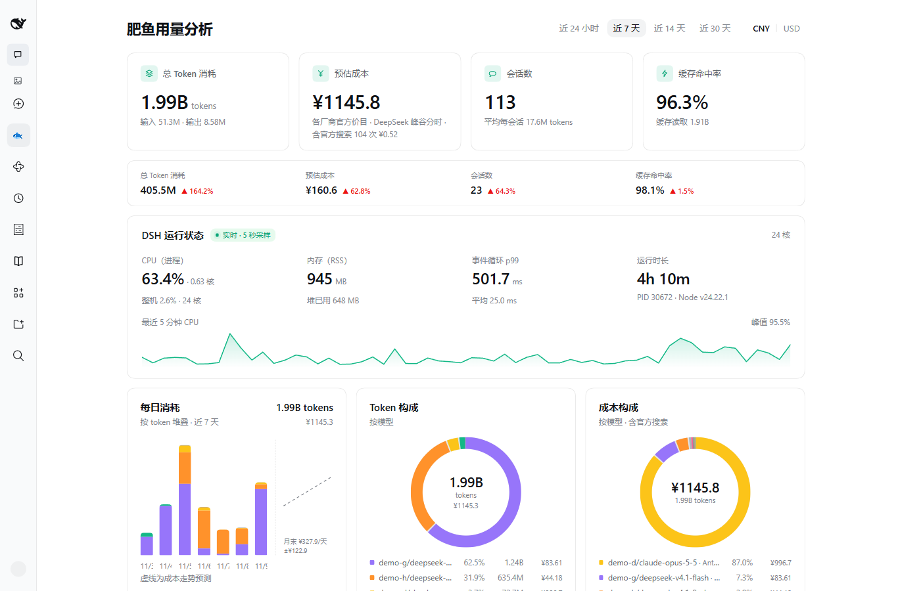
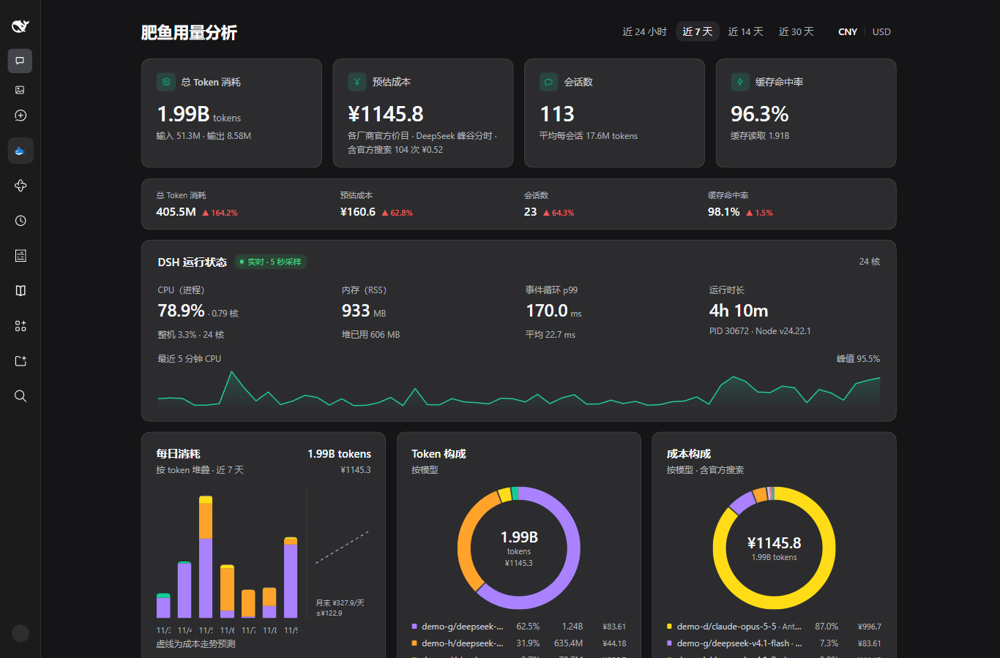
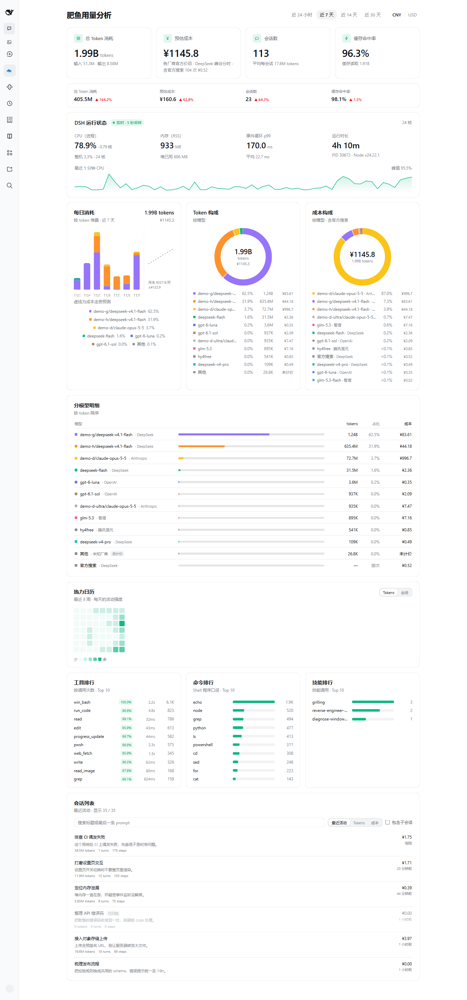

<p align="center"><a href="README.md">简体中文</a> | <strong>English</strong></p>

<div align="center">
  
  <h1>Fat Fish Usage</h1>
  <p>
    A usage stats page in the DeepSeek Harness sidebar.<br>
    See where tokens and money went, how today compares to yesterday, and how much CPU and memory DSH itself is using.
  </p>
  <p><b>Zero third-party dependencies</b> · charts are hand-written SVG · reads your local session log, uploads nothing</p>

  <p>
    <a href="https://www.npmjs.com/package/dsh-session-stats-panel"></a>
    
    <a href="LICENSE"></a>
    <a href="https://github.com/Oblivionis7999/dsh-session-stats-panel/stargazers"></a>
    <a href="https://github.com/Oblivionis7999/dsh-session-stats-panel/issues"></a>
    
  </p>

<a href="#what-is-it">What is it</a> • <a href="#screenshots">Screenshots</a> • <a href="#features">Features</a> • <a href="#install">Install</a> • <a href="#configuration">Configuration</a> • <a href="#panel-at-a-glance">Panel at a glance</a> • <a href="#data-and-privacy">Data & privacy</a> • <a href="#development">Development</a> • <a href="#faq">FAQ</a>
</div>

## What is it

A plugin for DSH. Once it is installed, the sidebar has a **Fat Fish Usage** page. Open it and you see how this machine has been using models. The name comes from the community nickname for DeepSeek: the little whale, also called the big blue fat fish.

You get:

- total tokens, a rough cost, and the cache hit rate (how much previous context was reused)
- how much each model used, and how much was used each day
- today vs yesterday, and roughly what the rest of the month will cost
- which of the last 8 weeks were busy, and which tools and commands you lean on
- what each session cost and what you last asked it

Everything is worked out from the local session log. The host side only exposes a few read-only endpoints; the browser side only draws. Every chart is hand-written SVG, so there is no charting library and no third-party dependency.

It uploads nothing, never writes to your session logs, and never calls the network. Prices come from a snapshot of vendor price lists bundled with the package.

> 3.0 dropped the candlestick mode from 2.x. The panel is a single stats view again, and the API is smaller.

## Screenshots

<table>
<tr>
<td width="50%" align="center"><a href="docs/screenshots/panel-light.png"></a></td>
<td width="50%" align="center"><a href="docs/screenshots/panel-dark.png"></a></td>
</tr>
<tr>
<td align="center">Light theme, last 7 days · demo data, redacted</td>
<td align="center">Dark theme, follows the host · demo data, redacted</td>
</tr>
</table>

<p align="center"><a href="docs/screenshots/panel-full.png"></a></p>
<p align="center">The whole page: model breakdown, activity calendar, three leaderboards and the session list · demo data, redacted</p>

## Features

| Feature | What it does |
| --- | --- |
| **Four metric cards** | Total tokens, estimated cost, sessions, cache hit rate. Switch window or currency in the top right; switching currency does not refetch |
| **Today at a glance** | Today against yesterday for the same four numbers: ▲ up, ▼ down, `—` when there is nothing to compare. A day with no usage shows four `—` and no error |
| **Daily consumption** | One bar per day, colored by model. The bars add up to the same total as the cards |
| **Token and cost donuts** | Two rings: one for how tokens split (uncached input, output, cache read, cache write), one for which model the money went to. The colors match the table below |
| **Cost forecast** | A straight line fitted to the last 30 days, drawn dashed to the end of the month with an approximate figure. Hidden when there are fewer than 7 usable days |
| **Activity heatmap** | One square per day for the last 8 weeks; darker means more usage. Toggle between tokens and sessions, hover for that day's numbers. Quiet days are a faint square, not a hole |
| **Tool / command / skill leaderboards** | Three lists, most calls first. Commands are the first word of a shell call, things like `cd` or `git`; tools also carry a success rate and average duration. Long names are cut off; hover to see the full one |
| **Session list** | One card per session: title, turns, steps, tokens, cost, last prompt. Search by title or prompt, sort by recent, tokens or cost. Subagent sessions are hidden until you tick the box |
| **Chunked loading** | The cards come up first; heatmap, leaderboards and sessions follow. Switching windows keeps the old data on screen with a progress bar on top |
| **Live runtime** | DSH's own CPU, memory, event-loop delay and uptime, sampled every 5 seconds, with a 5-minute CPU line underneath |
| **Theme aware** | Colors follow the DSH light/dark theme; there is no second hard-coded palette |
| **Vendor prices** | Priced only against each vendor's official list. A model with no official list is marked *unpriced* rather than guessed |

Measured on this machine (about 170 sessions, roughly 375 MB of logs): a cold full scan takes about 2.4 s and runs in the background 2 s after DSH starts, so the first open does not wait for it; the overview response is about 17 kB (it moves between 15 and 18 kB), heavy is about 48 kB, and heavy reuses the same scan, adding only 3 ms. Before 3.0 a single response was 62.8 kB, 72% of it the candlestick data that has since been removed.

## Install

This is a DSH plugin, not a separate app. `dsh plugin add` records the dependency in your profile and stacks the bundled `cordis.patch.yml` into the bundle layer, so you do not edit the profile by hand.

```powershell
# 1) from npm (recommended)
dsh plugin --profile web add dsh-session-stats-panel

# 2) straight from GitHub
dsh plugin --profile web add "git+https://github.com/Oblivionis7999/dsh-session-stats-panel.git"

# 3) local development: link into the profile, no file copy
dsh plugin --profile web add "link:E:\path\to\dsh-session-stats-panel"

# uninstall
dsh plugin --profile web remove dsh-session-stats-panel
```

> 3.1.x is already on npm, so you can install it directly; use option 2 to track the latest commit.

Then:

1. Stop DSH first. A running instance holds its dependencies open, so install and then start it again.
2. Run one of the commands above.
3. Restart DSH. Bundle list changes are not hot-reloaded.
4. Hard-refresh the browser with `Ctrl+Shift+R`. Client files are read when the page loads.
5. **Fat Fish Usage** shows up in the sidebar's page list (above *Plugins* and *Automation tasks*). Open it.

> The plugin does not open a new port and does not write user data. The host side only adds a few read-only endpoints to the local web service.

### Compatibility

| Plugin version | Status | DSH |
| --- | --- | --- |
| **3.1.x** (current) | ✅ Mainline: heatmap, three leaderboards, session list, today at a glance, cost forecast, chunked loading, tool success rates | `>= 0.2.1-rc.5` |
| 2.x | 🗄 Archived | `>= 0.2.1-rc.5` |

## Configuration

Every option has a default, so an empty config works. To change something, put it in `config` inside `cordis.patch.yml`:

```yaml
- insert:
    - id: session-stats-panel
      name: dsh-session-stats-panel
      config:
        window: 7d                # window on open: 24h | 7d | 14d | 30d
        usdRate: 7.1              # USD display rate; CNY is the source of truth
        timeZone: Asia/Shanghai   # which zone decides where "yesterday" starts
        ttlMs: 60000              # how long the overview response is cached, 0 = always recompute
        # Only turn this on when you open the UI from a phone or another machine on
        # your LAN. Public hostnames stay rejected, so a web page cannot use DNS
        # rebinding to read your local logs.
        allowPrivateHosts: false
```

| Key | Default | Meaning |
| --- | --- | --- |
| `window` | `"7d"` | Window used when the page opens: `24h` / `7d` / `14d` / `30d` |
| `usdRate` | `7.1` | CNY to USD display rate; affects the USD display only |
| `timeZone` | `"Asia/Shanghai"` | Which zone day and hour buckets use; set your own if you are elsewhere |
| `ttlMs` | `60000` | `overview` response cache; `0` recomputes on every request (per-session cache still applies) |
| `sessionConcurrency` | `3` | How many sessions are read in parallel during one scan (1–16) |
| `readTimeoutMs` | `10000` | How long a single session read may take; a timeout skips that session and logs it |
| `liveIntervalMs` | `5000` | CPU sample interval for `/live` (1000–60000) |
| `livePoints` | `60` | Points kept for the CPU line (6–600); 5s × 60 = 5 minutes by default |
| `allowedHosts` | `[]` | Extra host names to allow, for a reverse proxy |
| `allowPrivateHosts` | `false` | Allow private ranges, `*.local` and single-label host names |
| `holidays` | built-in 2026 list | Beijing dates billed at off-peak prices; pass `[]` to clear it |
| `makeupWorkdays` | built-in 2026 list | Weekend dates worked as make-up days, billed at peak prices |
| `debug` | `false` | Verbose scan logging |

> **Do not change the loader id; it is `session-stats-panel` on purpose.** The official `@deepseek-ai/dsh-session-stats` plugin uses `session-stats`, and the loader keys bundles by id with later entries winning. On a collision the official `sessionStats` projection silently never mounts: nothing looks broken, you just lose the streaming timing data.

How prices and peak hours work is in [docs/PRICING.md](docs/PRICING.md). Endpoints and fields are in [docs/API.md](docs/API.md).

## Panel at a glance

| Area | Content |
| --- | --- |
| Top bar | Window (24h / 7d / 14d / 30d) and currency (CNY / USD) |
| Metric cards | Total tokens, estimated cost, sessions, cache hit rate, each with a secondary line |
| Today at a glance | Today's four numbers against yesterday, with ▲ / ▼ / `—` |
| Runtime | CPU (process, machine, cores), memory, event-loop delay, uptime, PID and Node version, with a 5-minute CPU line |
| Daily consumption | Daily stacked bars colored by model; with the forecast on, a dashed line runs to the end of the month |
| Donuts | Token buckets, plus cost share by model, with totals in the middle |
| Model breakdown | Swatch, model (with provider), share bar, tokens, share, cost, sorted by tokens |
| Heatmap | The last 8 weeks of activity, in token or session mode |
| Leaderboards | Top ten tools, commands and skills, bars scaled to the leader |
| Session list | Up to 50 session cards with search and sorting; subagent sessions hidden by default |

On narrow screens the three chart cards go from three columns to two below `1100px` and one below `720px`. Cards, heatmap, leaderboards and the list do not overflow sideways.

## Data and privacy

- **Read-only.** It calls `ctx.sessionQuery.listSessions()` and `readSession()`, and reads usage, `tool/call`, `turn/start`, `step/start`, `user/message` and `session/title` records. Nothing is written back. A corrupt log, a read timeout or a bad timestamp skips that session and leaves the rest alone.
- **No uploads, no network calls.** No telemetry, no remote requests. The price table is a bundled snapshot that never refreshes itself.
- **Loopback only.** By default only `127.0.0.1` / `localhost` / `[::1]` are accepted. Anything else gets a `403`, and the response tells you which switch to flip. Every response carries `Cache-Control: no-store`.
- **Incremental reads.** Each session has a revision marker from the persistence backend that shows whether it changed. Only changed sessions are re-read; the rest come from memory. Without a persistence backend this falls back to a per-session `ttlMs` expiry. Memory keeps the last 31 days, one bucket per hour.
- **Fork dedupe.** A session cloned from another (`isSeeded`) starts with a copy of its parent's events, and `inheritedEventCount` from `readSession()` is that prefix length. It is cut off before counting, so only the session's own new events count. That prefix is about 7.8% of all tokens on this machine; older versions counted it twice, fixed in 3.0.
- **Money is an estimate.** Each event is priced against the vendor's official list. DeepSeek has peak and off-peak prices; other vendors are flat. USD lists are converted at `usdRate`. A model with no official list is marked *unpriced* with cost 0, not guessed.
- **Web search is billed per request.** Every search is a separate request at ¥0.005, added to the cost card on its own line. The search call's own token usage is not in the log, so it cannot be reconstructed locally.

## Development

Zero dependencies. `npm install` is only needed for host peer dependencies; the self-checks are offline, do not start DSH, and do not write user data.

```powershell
# syntax check
node --check index.js
node --check lib\index.js
node --check lib\pricing.js
node --check lib\aggregate.js
node --check client.js

# three self-check suites: core / host / client
node tools\selfcheck.mjs
node tools\selfcheck-host.mjs
node tools\selfcheck-client.mjs

# or all at once
npm run selfcheck
```

- `tools/selfcheck.mjs`: feeds fake events through the math that produces tokens, cost, hit rate, daily totals and model share, plus the data behind the heatmap, leaderboards and session list
- `tools/selfcheck-host.mjs`: runs `apply()` against a fake `ctx` and calls the endpoint handlers directly (no port is bound), checking payload shape, host and method rules, caching and the warm-up timer
- `tools/selfcheck-client.mjs`: renders the page with a fake `window` / `document` / React, checking copy, numbers, heatmap cell count, leaderboard widths, search, sorting and empty states

What a change needs to show up:

| Change | How it applies |
| --- | --- |
| `lib/*.js` (host) | Restart DSH, then hard-refresh the browser |
| `client.js`, `locale/*.json` (browser) | Just refresh the page; client plugins hot-reload |
| `cordis.patch.yml` (config, mounting) | Restart DSH |

## Project layout

```text
dsh-session-stats-panel/
├─ package.json          # name / type: module / main: lib/index.js / dsh.bundle.patch / dsh.client
├─ cordis.patch.yml       # bundle patch: inserts this plugin row (optional config inside)
├─ icon.svg               # plugin manager / marketplace icon
├─ locale/{zh,en}.json    # package metadata copy for the plugin list
├─ index.js               # host alias entry, re-exports lib/index.js
├─ lib/
│  ├─ index.js            # host: routes, incremental scan cache, /live sampling (package main)
│  ├─ pricing.js          # pure functions: price table, peak detection, costOfUsage, USD conversion
│  └─ aggregate.js        # pure functions: events → hour buckets → window / day / model / heatmap / leaderboards / session list
├─ client.js              # browser half: __ModuleLoader__ wrapper, React + inline SVG
├─ docs/
│  ├─ API.md              # endpoints and response fields
│  ├─ PRICING.md          # price snapshot, peak rules, unpriced list
│  └─ screenshots/        # screenshots used by the README
├─ tools/
│  ├─ selfcheck.mjs       # core self-check
│  ├─ selfcheck-host.mjs  # host endpoint self-check
│  └─ selfcheck-client.mjs# client render self-check
├─ README.md / README_en.md
└─ LICENSE
```

## FAQ

**The metric cards appear first and the heatmap shows up later. Is that normal?**
Yes, that is the chunked load. Metrics and charts come from `/overview` and render straight away; heatmap, leaderboards and the session list come from `/heavy` in a second request. Switching windows keeps the old data on screen and shows a 2px progress bar on top.

**I changed code and nothing happened.**
The host (`lib/*.js`) needs a DSH restart plus a hard refresh. The browser side (`client.js`, `locale/*.json`) just needs a page refresh, because client plugins hot-reload.

**Why does CPU show 120%?**
The number is process CPU time divided by wall-clock time. V8's background compilers, garbage collection and file decompression run on other threads, so one process can use more than one core. 120.8% means 1.21 cores. The machine share next to it is what the whole box used.

**Why is a model marked "unpriced"?**
Only vendor price lists are used. A model with no public per-token price (a retired version, an internal model) is not estimated: cost stays 0, the row says *unpriced*, and the table footer tells you how many models were left out.

**The panel total does not match my bill.**
Two reasons. It only counts `assistant/message` events that carry usage, so calls without usage are not estimated. And web search is billed per request, while the search call's own tokens never reach the log. The panel is an estimate, not a bill.

**I cannot open it from my phone or another computer.**
Only loopback is allowed by default. For LAN access turn on `allowPrivateHosts`; for a reverse proxy put the domain in `allowedHosts`. Public hostnames stay rejected.

**"Last 7 days" does not use my time zone.**
`timeZone` defaults to `Asia/Shanghai`; set your own. DeepSeek's peak hours are defined in Beijing time by the vendor and do not follow this setting.

**Does it conflict with the official `@deepseek-ai/dsh-session-stats`?**
No. This plugin's loader id is `session-stats-panel` and the official one is `session-stats`, so both can be mounted.

## Credits

- [DeepSeek Harness](https://github.com/deepseek-ai): the host for plugins, the ModuleLoader and the sidebar slots
- The README layout follows [dsh-ssh-tunnel](https://github.com/OMSociety/dsh-ssh-tunnel) and [dsh-github-workbench](https://github.com/meyaomiao/dsh-github-workbench)
- Prices come from vendor pricing pages; fetch dates and links are recorded in [docs/PRICING.md](docs/PRICING.md)

If it is useful, a Star ⭐ is welcome. Issues go to [Issues](https://github.com/Oblivionis7999/dsh-session-stats-panel/issues), and per-version notes to [Releases](https://github.com/Oblivionis7999/dsh-session-stats-panel/releases).

## License

[MIT](LICENSE) © 2026 织风裁月 (Oblivionis7999). The price table is a snapshot of vendor-published prices, used for local estimates only, not as a bill.
